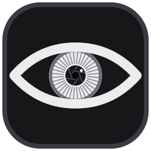
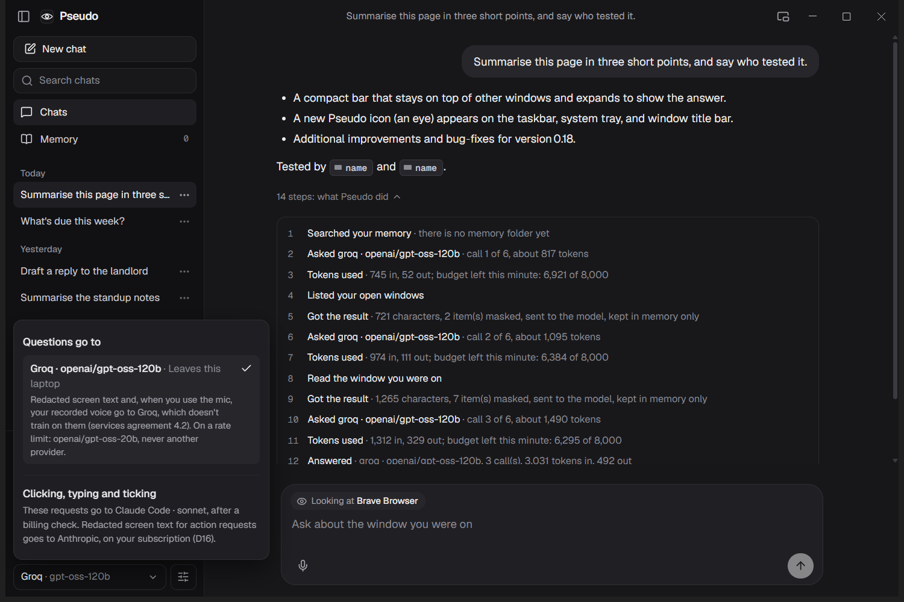
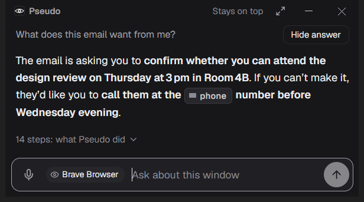
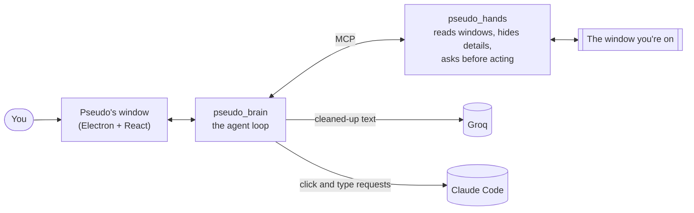

<p align="center">
  
</p>

<h1 align="center">Pseudo</h1>

<p align="center">
  A private AI helper for your Windows laptop.<br>
  It reads the window you're looking at, hides your personal details,<br>
  and answers your questions about it.
</p>



<p align="center"><i>Ask "summarise this page" and Pseudo reads the page you were on. The two names on it never left the laptop: they were hidden first and sent as "name".</i></p>

## What is Pseudo?

Pseudo is a helper that lives on your laptop. You can ask it about whatever you're looking at: an email, a web page, a form. It reads that window and answers.

Before anything goes to the AI, Pseudo removes your personal details on your own computer: names, phone numbers, email addresses and more. The AI only ever sees a cleaned-up version. That's where the name comes from: a *pseudonym* hides who you are.

## What it can do

- **Explain the window you're on.** "What does this email want from me?" "Summarise this page."
- **Keep your details private.** Names, numbers and emails are hidden before anything leaves your laptop. Apps you mark as private are never read at all.
- **Click and type for you, but only if you say yes.** "Tick *Send me reminders*." Every action shows a popup first, and the answer is *no* unless you click OK.
- **Remember past tasks, only if you say yes.** After an answer, it asks whether to save it. Saved notes stay on your laptop.
- **Listen and talk.** Press the mic and speak your question; answers can be read aloud.
- **Stay out of your way.** A small bar can float on top of your other windows (below). A shortcut, Ctrl+Alt+Enter, shows or hides Pseudo from any app. It can also start with Windows, quietly, as an icon by the clock.



<p align="center"><i>The compact bar stays on top while you work. Here it explains an email; the phone number in it was hidden before anything was sent.</i></p>

## How it keeps your information yours

- **Text, never pictures.** Pseudo reads the words on a window the way a screen reader does. It never takes or sends screenshots.
- **Hidden first.** Personal details are found and replaced on your laptop, before anything is sent.
- **You approve every action.** Clicking, typing or saving always asks you first in a popup.
- **It never reads itself,** and never reads apps you've marked private.
- **It says where your words go.** Questions go to Groq, a free AI service. Requests to click or type go to Claude, on your own Claude subscription. Settings shows this, and every answer's steps say who answered.
- **Your history stays home.** Chats and saved notes are kept on your laptop only.

## Built to learn

Pseudo is a learning project. It was built step by step, in small milestones (M0 to M45), by [Claude Code](https://claude.com/claude-code), while its owner learned how AI agents work. Each step has a plain-language lesson in [`docs/learn`](docs/learn), starting with [M0: setup](docs/learn/M0-setup.md). It costs nothing to run: free AI tiers only.

---

## For developers

Windows only. You'll need Python 3.11 or newer, Node.js 24 or newer, and a free [Groq](https://console.groq.com) API key. Claude Code is optional; it's used for click-and-type requests.

```powershell
# The Python side: the brain and the "hands" that read windows
python -m venv .venv
.\.venv\Scripts\Activate.ps1
pip install -r requirements.txt
Copy-Item .env.example .env      # then put your Groq key in LLM_API_KEY

# The window
cd face
npm install
npm start                        # builds and opens Pseudo
npm run package                  # optional: builds face\out\Pseudo\Pseudo.exe
```

`.env` holds your keys and is never committed. If `npm start` says it can't find Electron, run `Remove-Item Env:ELECTRON_RUN_AS_NODE` first (some editors set it). `Pseudo.exe` runs from this folder's `.venv`, so build it on the machine you'll use it on.

Tests: `python -m pytest` in the repo, and `npm test` in `face`.

**How it fits together**



More in [ARCHITECTURE.md](ARCHITECTURE.md), the decisions behind it in [DECISIONS.md](DECISIONS.md), and the full plan in [PRD.md](PRD.md).

## License

[MIT](LICENSE). The names list comes from Wikidata (CC0). Pseudo is built on Presidio and spaCy (for hiding details), Electron and React (for the window), the Geist font and lucide icons.
