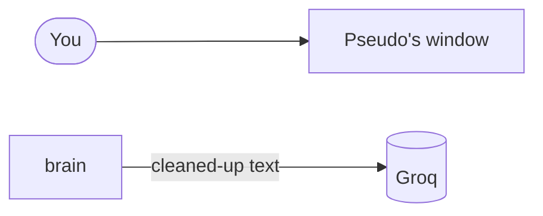

# M45: README for GitHub

## The concept in one paragraph

A README is the front door of a repository: the first page a visitor sees on GitHub. Until M45, Pseudo's README was a work log written for its owner, milestone by milestone, and much of it was out of date. M45 rewrote it for **anyone**, including someone who has never heard of an AI agent. Pictures come first, then plain sentences about what Pseudo does and how it keeps your information private, and the technical setup comes last, under "For developers". The milestone also added a **license**, which decides what visitors may legally do with the code, and the screenshots were made with **fake data only**.

## Web-dev analogy

**The README** is a landing page. The hero image and one sentence must explain the product; the docs live behind links.

**"For developers" at the bottom** is the footer's "Docs" link: there for those who need it, out of everyone else's way.

**The local preview** is a staging environment. The page is rendered exactly as production (GitHub) would render it, on 127.0.0.1, before anything goes live.

**The MIT license** is like choosing a package's `"license"` field in `package.json`. Without one, a public repo is "all rights reserved": readable, but not reusable.

## What was built (file by file)

| File | What it is |
|---|---|
| `README.md` | 89 lines for a visitor: two screenshots, what Pseudo does, privacy in plain words, then setup and a diagram. |
| `docs/images/pseudo-window.png` | The full window summarising a fake "release notes" page; names shown as "name" chips. |
| `docs/images/pseudo-bar.png` | The compact bar explaining a fake meeting email; the phone number shown as a "phone" chip. |
| `pseudo_hands/README.md`, `pseudo_brain/README.md` | Short and current; the full file lists live in ARCHITECTURE.md. |
| `LICENSE` | The MIT license text. |

## Walkthrough of the key pieces

**1. Lead with the picture.** The README opens with the icon, one sentence, then the hero screenshot and a caption that says what you're looking at:

```markdown

```

The text in `![...]` is the image's description for screen readers and broken images. Write what the picture *shows*, not "screenshot".

**2. Plain words, then detail.** Each feature is one bullet a non-technical reader can follow: "Click and type for you, but only if you say yes." The words *MCP*, *redactor* and *UI Automation* appear only below the line, under "For developers".

**3. A diagram that stays text.** GitHub draws Mermaid diagrams from a code block, so the diagram is editable text in the repo, not an image that goes stale:

````markdown

````

**4. One list in one place.** The part READMEs used to repeat the file list and fell out of date (they stopped at M24 and M26). Now they say what each part does and link to ARCHITECTURE.md, which every milestone updates. A fact written in two places drifts apart; a link can't.

**5. Fake data, real app.** The screenshots come from the real packaged Pseudo, answering with the real model, in a temporary profile with fake chats and two fake web pages. Before each capture, the script checks that the fake page is the window Pseudo would read and that the look-at chip names it. Only Pseudo's own window is captured.

## What happens when you run it (annotated real output)

```
hero: ready True | Speak answers off True | fake page's app 'Brave Browser'
  asked True | answered True
  steps opened True | picker opened True
  hero: drawn True, 1500 x 1000
```

The hero shot took three tries, and each failure taught something:
- **Try 1:** the model listed the windows and asked which page to summarise (the habit in the Backlog).
- **Try 2:** the summary was good, but the fake names were at the bottom of the page, past the 1,200 characters Pseudo sends. So nothing showed as masked. Moving them to the top fixed it.
- **Try 3:** "7 item(s) masked, sent to the model" in the steps, and the names in the answer as "name" chips.

```
README.md: rendered by GitHub, 9232 characters of HTML
```

The preview sent the README's text to GitHub's Markdown API, which renders it exactly as github.com does, and served the result on 127.0.0.1 with GitHub's stylesheet. After the owner's OK it was pushed, and `gh repo view` reported the license as "MIT License".

## Try this (3 small experiments that break or change something)

1. In `README.md`, change `docs/images/pseudo-bar.png` to `docs/images/bar.png` and open VS Code's Markdown preview (Ctrl+Shift+V): the image breaks and only its description shows. That's why the description matters. Put it back.
2. In the Mermaid block, change `flowchart LR` to `flowchart TD` and preview it on <https://mermaid.live>: the diagram turns from left-to-right into top-to-bottom. Put it back.
3. Delete the first line of `LICENSE` ("MIT License"), and ask yourself: would GitHub still recognise it? It matches license texts by their content, so small edits can make it "Other". Put it back without committing.

## Check yourself

1. Who is the main README written for now, and where did the technical setup go?
2. Why do the part READMEs link to ARCHITECTURE.md instead of listing every file?
3. What does a public repo with no license allow visitors to do?
4. Why were the screenshots made in a temporary profile with fake pages?
5. Why did the second hero attempt show no masked names?

<details>
<summary>Answers</summary>

1. Anyone, including non-technical readers. The setup is at the end, under "For developers".
2. ARCHITECTURE.md is updated every milestone; a second copy of the list drifts out of date, as the old ones did.
3. Read it. With no license it is "all rights reserved", so reusing the code isn't allowed. MIT allows reuse with the notice kept.
4. So no real chat, memory or window could appear in a public image (Phase 10's rule).
5. The names were at the bottom of the page, beyond the 1,200 characters Pseudo reads and sends, so they never reached the model to be shown as chips.

</details>

## How this connects to Pseudo's final architecture

M45 changes no code: it's the public face of everything before it. With it, Phase 10 is complete. Pseudo now has a calm, dark window with a sidebar, a compact bar, its own icon and name, and a front page that explains it to anyone. The Backlog (PRD section 17) lists what could come next, starting with letting the billing check accept more than one Claude account.
